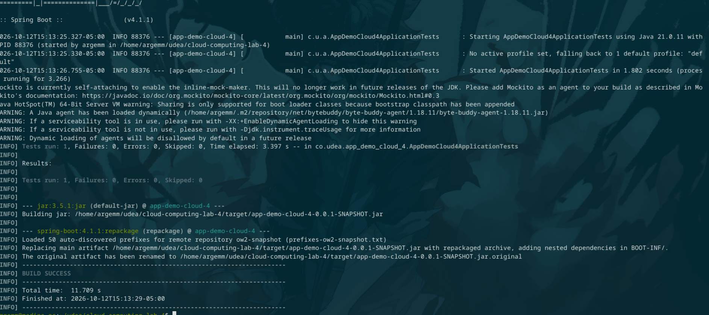
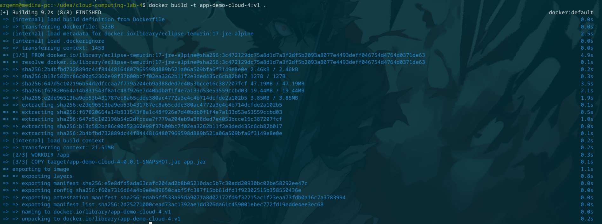
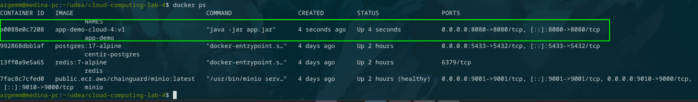
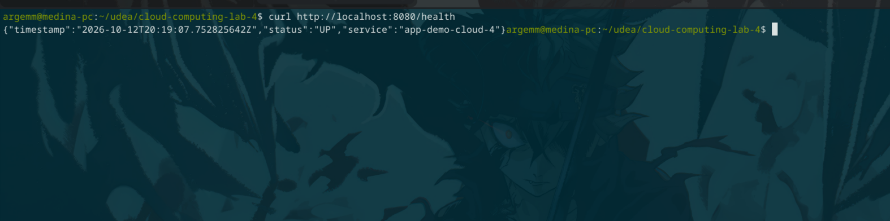
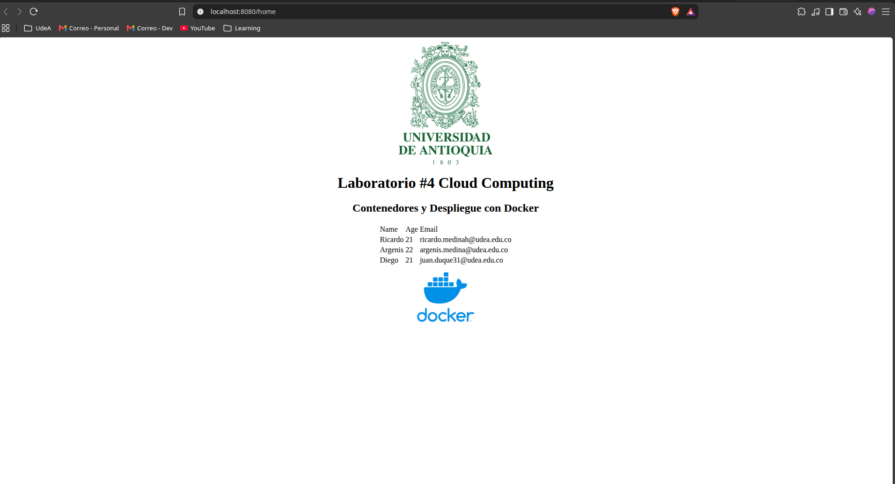
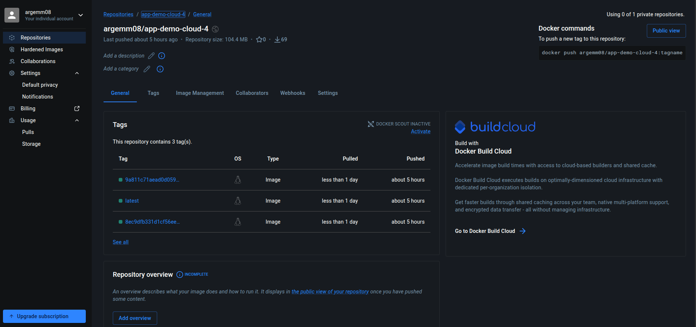

# Laboratorio 4 — Contenedores y Despliegue con Docker

Computación en la Nube · UdeA 2026

Integrantes: Ricardo, Argenis y Diego.

## Descripción

Aplicación web hecha con Spring Boot (Java 17) empaquetada en una imagen Docker y publicada en Docker Hub. Expone dos endpoints:

| Endpoint  | Descripción                                              |
|-----------|----------------------------------------------------------|
| `/home`   | Página HTML con la lista de integrantes del grupo        |
| `/health` | JSON con el estado del servicio (`status`, `service`, `timestamp`) |

## Estructura

```
.
├── Dockerfile
├── .dockerignore
├── .github/workflows/docker-publish.yml   # build y push automático a Docker Hub
├── docs/capturas/                         # evidencias del laboratorio
├── pom.xml
└── src/
```

## Dockerfile

```dockerfile
FROM eclipse-temurin:17-jre-alpine
WORKDIR /app
COPY target/app-demo-cloud-4-0.0.1-SNAPSHOT.jar app.jar
EXPOSE 8080
ENTRYPOINT ["java", "-jar", "app.jar"]
```

Se usa la imagen JRE sobre Alpine para que el resultado sea liviano: solo trae lo necesario para ejecutar el jar, sin Maven ni el JDK completo. El `.dockerignore` deja pasar únicamente el jar al contexto de build.

## Paso a paso

### 1. Compilar el proyecto

```bash
./mvnw clean package
```



### 2. Construir la imagen

```bash
docker build -t app-demo-cloud-4:v1 .
```



### 3. Ejecutar el contenedor

```bash
docker run -d -p 8080:8080 --name app-demo app-demo-cloud-4:v1
docker ps
```



### 4. Probar el servicio

Desde el navegador o con curl:

```bash
curl http://localhost:8080/health
```





### 5. Publicar en Docker Hub

```bash
docker tag app-demo-cloud-4:v1 <usuario>/app-demo-cloud-4:v1
docker login
docker push <usuario>/app-demo-cloud-4:v1
```



## Cómo mejora Docker el despliegue

- **Portabilidad:** la imagen lleva el jar y el runtime de Java, así que corre igual en cualquier máquina con Docker, sin instalar nada más.
- **Aislamiento:** la aplicación corre en su propio contenedor y no depende de las versiones de Java ni de las librerías del equipo anfitrión.
- **Reproducibilidad:** el Dockerfile describe cómo se arma el entorno, por lo que cualquier integrante obtiene el mismo resultado.
- **Escalabilidad:** al ser una imagen versionada se pueden levantar varias réplicas del mismo contenedor, o llevarlo a un orquestador, sin cambiar la aplicación.
- **Distribución:** Docker Hub funciona como punto central para compartir y versionar la imagen.
